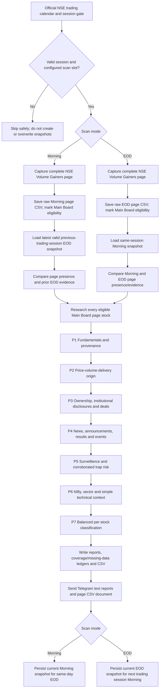

# ECMS end-to-end workflow design and P0–P8 implementation plan

**Decision baseline:** 16-Nov-2026  
**Repository:** `digitalmf78-pixel/AI-Trading-Bot`  
**Workflow:** `.github/workflows/ecms-volume-gainers-shadow.yml`

This document is the implementation map for the approved ECMS strategy. It does not authorize changes to NSE V8, shared providers/caches, production selection logic, broker execution, basket construction or historical backtesting.

## 1. Purpose and operating boundaries

ECMS researches every eligible Main Board equity returned by the NSE Volume Gainers page. It explains whether unusual volume has positive demand/accumulation evidence, negative selling/distribution evidence, a company/event catalyst, mixed signals or suspicious/high-risk characteristics.

A Volume Gainer is a **research candidate**, not a buy signal. No profit is guaranteed. Stocks are assessed individually; there is no basket construction, backtesting, auto-buy/sell or broker integration.

The NSE page currently labels its table “Top 25”. “All page stocks” means every row actually returned by the page response, not the entire NSE Main Board universe. Preserve all raw page rows in the downloadable Morning/EOD CSV and mark Main Board eligibility. Only eligible Main Board equities enter the ECMS research universe.

## 2. End-to-end daily flow

### Morning → EOD → next Morning state cycle

- **Morning of a trading session:** load the latest valid EOD snapshot from the previous trading session (not simply the previous calendar date). Compare it with the current Morning page and run the Morning research. Persist the current Morning snapshot only after its required report/persistence steps succeed.
- **Same-session EOD:** load that session's Morning snapshot, compare Morning and EOD page presence and update the research with completed-session data. Persist the EOD snapshot as the next trading session's Morning reference.
- **Next trading-session Morning:** consume the previous valid EOD reference only after its comparison/report persistence succeeds. A failed Morning comparison must not destroy the prior EOD reference.
- **Holiday/weekend:** skip the scan and do not create, consume or overwrite trading-session snapshots.
- **Friday EOD → Monday Morning:** compare Friday's EOD snapshot with Monday's Morning scan, provided Monday is an official trading session. If Monday is a holiday, the next valid session uses Friday's EOD.
- **Calendar uncertainty:** use only official NSE Capital Market–Equities calendar notices. Unknown calendar coverage or unconfigured special-session time fails closed; never infer holidays or special-session dates.

### Page capture and universe rules

1. Capture the NSE Volume Gainers page response and its capture/session timestamps.
2. Preserve every row returned by that page in the mode-specific CSV, including rows outside the Main Board research universe.
3. Add Main Board eligibility and the reason/source used to determine it.
4. Do not apply a Top-20/Top-25 research cap after capture. Research every eligible Main Board equity row.
5. Keep page-presence labels (new/repeated/disappeared) separate from fundamental PASS/FAIL/WAIT and from the final balanced classification.
6. Keep Morning and EOD CSVs and reports separate.

## 3. Research layers and evidence rules

### P1 — Fundamental quality

Collect seven applicable metrics for every eligible page stock:

- Revenue Growth
- Profit Growth
- ROE
- ROCE
- Debt/Equity
- Interest Coverage
- Operating Cash Flow

For every metric retain value, source, source URL, period end, publication date, consolidated/standalone basis, unit/currency, calculation method and verification status. Apply sector-specific applicability for banks, NBFCs and insurers.

**Decision policy:** a complete, current, period/basis-aligned and sufficiently official-verified set may pass or fail the approved fundamental rules. Missing, partial, stale, conflicting or unverified evidence remains WAIT/PARTIAL/STALE/CONFLICT and continues to other research layers. Do not call it a fundamental PASS or “fundamentally strong”. Never invent, silently average or overwrite conflicting values. Third-party data is provider evidence until reconciled to official filings.

### P2 — Positive/negative volume origin

Assess price, volume, traded value, liquidity, delivery quantity/percentage/value and follow-through. Use completed-session 5/10/20/30-session context where reliable. Compare up-day and down-day behaviour. Do not compare partial Morning volume directly with full-day averages. High delivery alone does not prove accumulation; a single volume spike does not prove distribution.

### P3 — Institutional and ownership evidence

Collect official quarterly shareholding changes, promoter holding/pledge, FII/DII observations and insider disclosures only where issuer/security mapping and source are verified. Add stock-specific NSE/BSE bulk/block deals with date, disclosed client/side, quantity, price and official source. Never infer an institutional buyer from delivery percentage or market-wide flows.

### P4 — News, announcements and events

Match issuer/security carefully. Capture official announcements, results, announced result dates, orders/contracts, material business updates, corporate actions and relevant news. Preserve publication date, event date, source type, URL and match confidence. If a date is not officially announced, report NOT ANNOUNCED rather than estimating it.

### P5 — Trap and surveillance risk

Check official ASM/GSM/ESM, Trade-to-Trade, Periodic Call Auction, price-band and exchange surveillance status. Combine official status with corroborating multi-session price/volume or disclosure evidence. **Exclude only for severe risk supported by a validated rule or corroborated evidence.** Maintain an exclusion ledger with symbol, session/date, source, evidence, severity and reason. Missing data or one weak signal is not a trap.

### P6 — Market and technical context

Add Nifty and sector strength, stock relative strength, simple trend/breakout/retest/closing-strength observations and liquidity/exit readiness. Keep this layer proportionate and avoid redundant or costly data collection.

### P7 — Balanced per-stock decision

Combine the separate evidence layers without hiding missing data in an opaque score. Suggested transparent labels:

- `POSITIVE_EVIDENCE`
- `NEGATIVE_EVIDENCE`
- `EVENT_DRIVEN`
- `MIXED_SIGNALS`
- `SUSPICIOUS_HIGH_RISK`
- `INSUFFICIENT_DATA`

Show confidence, reasons, evidence dates, source links and missing-data caveats. A classification is a research conclusion, never an automatic trade instruction.

## 4. P0–P8 delivery roadmap and phase gates

Work strictly in order. A phase is not complete because code was committed or unit tests passed alone. Each phase needs its stated runtime/data evidence. Do not begin the next phase until the current phase's acceptance evidence is reviewed.

| Phase | Scope | Required implementation | Acceptance evidence / exit gate |
|---|---|---|---|
| **P0 — Workflow protection** | Lifecycle, session dates, snapshots, cache, reports, Telegram, ECMS/V8 isolation | Verify official calendar/session gate; Morning previous-EOD restore/compare/consume; EOD same-day-Morning compare/save; holiday/failed-run safety; separate ECMS fundamental cache; complete page CSV and Telegram document delivery; preserve V8 workflows/providers/caches/thresholds. | Actual successful Morning and EOD runtime runs for both comparison legs; correct Friday/holiday/next-session handling; failed Morning does not consume EOD; no stale snapshot resurrection/overwrite; cache hit/reuse/provider-skip and save logs; both CSV Telegram deliveries confirmed; V8 regression checks pass. |
| **P1 — Fundamentals** | Seven-metric completeness and official verification | Per-stock/per-metric provenance; period, basis, unit and sector applicability; conflict/missing/stale states; persistent ECMS-only cache; retry and cache reuse; fundamental gate only for complete verified data. | Coverage matrix across all eligible stocks and seven metrics; source/official verification evidence; explicit PASS/FAIL/WAIT/PARTIAL counts; audited examples for each state; repeat-run cache reuse/provider-skip evidence; no incomplete-data false rejection. |
| **P2 — Volume origin** | Buying vs selling evidence | Price/volume/liquidity; session-aligned RVOL; delivery history for 5/10/20/30 completed sessions where available; up/down-day comparison; Morning/EOD follow-through. | Per-stock report with source and session dates; delivery/volume missingness explicit; test examples for positive, negative, mixed and insufficient evidence; no partial/full-session comparison errors. |
| **P3 — Institutional evidence** | Ownership, pledge, insider and deals | Official quarterly shareholding/promoter/pledge changes; verified insider filings; stock-specific bulk/block deals; mapping and period validation. | Source-attributed records with issuer, security, disclosure date, period and units; verified deal rows; no inferred institution identity; unavailable data clearly marked. |
| **P4 — News and events** | Catalyst and calendar context | Issuer-matched announcements, orders, results/result dates, corporate actions, upcoming events and relevant news; distinguish publication date from event date. | Auditable source URLs and date fields; correct issuer matching; announced vs not-announced distinction; Morning-to-EOD update evidence; no invented event dates. |
| **P5 — Trap/surveillance** | Evidence-backed risk exclusion | Official surveillance status plus validated corroborating signals; severity rules; exclusion ledger and reason codes. | Test cases for confirmed severe risk, single weak signal and missing data; only validated severe/corroborated cases excluded; full exclusion provenance. |
| **P6 — Market/technical context** | Sector, index and simple chart context | Nifty/sector relative strength, trend, breakout/retest, closing strength, liquidity and exit readiness. | Session-aligned and source-attributed outputs; market/sector context visible; missing inputs explicit; no heavy or duplicate indicators. |
| **P7 — Balanced classification** | Final research conclusion | Combine P1–P6 evidence into transparent per-stock labels, reasons and confidence; preserve independent layer statuses and exclusion reasons. | Auditable examples across all labels; every label traceable to evidence; WAIT/missing data not silently promoted or rejected; no opaque forced score or automatic trade instruction. |
| **P8 — Live shadow validation** | Operational proof and user review | Run only the existing Morning/EOD workflows on live sessions; inspect artifacts, reports, Telegram, snapshots, cache and data coverage; record defects and retest fixes. | Multiple real Morning/EOD cycles including a weekend/holiday transition where available; repeatability, data quality, delivery and state continuity accepted by user. **No historical backtesting.** |

## 4A. Detailed execution instructions — what to do inside each phase

This section is the task-by-task work order. Before editing code, inspect the current implementation and workflow logs, identify the exact gap, and change only the ECMS-owned files required for that gap. Do not reimplement an already-working feature without evidence.

### P0 — Workflow protection: exact task order

1. **Audit workflow triggers and jobs.** Inspect `.github/workflows/ecms-volume-gainers-shadow.yml`: scheduled Morning/EOD UTC-to-IST times, manual mode inputs, job conditions, permissions, concurrency, timeouts and artifact upload. Confirm Morning and EOD can be run independently for testing.
2. **Audit official session gate.** Inspect the NSE Capital Market–Equities calendar input and parser. Confirm weekends, declared holidays, special sessions, unknown years and wrong clock slots. Unknown calendar data must skip safely; never guess a session.
3. **Audit session-date identity.** Every run must distinguish workflow run date, IST capture date, intended NSE session date, previous trading session and data-as-of date. Do not derive previous session by subtracting one calendar day.
4. **Test Morning snapshot restore.** Morning must locate the latest valid unconsumed EOD snapshot from the previous trading session. Validate schema, session date, mode and checksum/version where supported.
5. **Test Morning comparison and consume order.** Compare previous EOD with current Morning page. Persist Morning outputs/snapshot successfully before marking the previous EOD reference consumed. On failure, keep the previous EOD snapshot usable for retry.
6. **Test EOD snapshot lifecycle.** EOD must load the same-session Morning snapshot, compare Morning vs EOD page, write EOD output and persist the EOD snapshot for the next trading session.
7. **Test stale-cache/resurrection cases.** Restore overlapping caches in a test scenario; confirm a consumed EOD snapshot cannot reappear as active from a legacy cache. A holiday or failed run must not create a fresh snapshot or overwrite a valid one.
8. **Verify ECMS cache isolation.** Confirm fundamental workspace restore/save uses ECMS-only cache keys/paths. Check actual cache hit, symbols/metrics reused, provider requests skipped, cache save and retry behaviour. Do not modify shared V8 cache.
9. **Verify complete page CSV.** Both Morning and EOD CSVs must preserve every row returned by the NSE page, raw fields, capture timestamp, scan mode/date, source URL and Main Board eligibility/reason. No silent Top-N truncation.
10. **Verify Telegram and artifacts.** Confirm text report and CSV document send for both modes; log filename, bytes, Telegram message ID and errors. Confirm workflow artifact contains the same CSV/report files.
11. **Run regression checks.** Run ECMS tests and NSE V8 regression tests. Inspect changed-file list and workflow diff to prove no V8 schedule/provider/threshold/cache/selection change.
12. **Collect live evidence.** Run manual EOD and Morning separately on main when appropriate. Inspect job logs, artifacts, Telegram receipt, snapshots and cache logs. Exercise a real next-session comparison. Record any missing evidence; do not mark P0 complete on unit tests alone.

**P0 deliverables:** workflow audit note, session/snapshot lifecycle evidence, cache proof, Morning/EOD CSV and Telegram proof, V8 regression result.

### P1 — Fundamentals: exact task order

1. Enumerate every eligible Main Board page symbol before research filtering. Build a symbol-to-issuer mapping and retain unresolved symbols as explicit rows.
2. Define a metric registry for the seven metrics: Revenue Growth, Profit Growth, ROE, ROCE, Debt/Equity, Interest Coverage and Operating Cash Flow. For each define formula, period, units, acceptable source, sector applicability and threshold policy.
3. Inspect available providers and official NSE/BSE issuer filings. Record actual source coverage before adding another provider. Prefer official filings; third-party values are comparison evidence until reconciled.
4. Collect each metric independently. Preserve raw observation, normalized value, source URL, publication date, period end, consolidated/standalone basis, unit/currency, calculation method and provider/verification status.
5. Align periods and accounting basis before comparison. Do not compare consolidated value with standalone filing or mismatched financial periods as if equivalent.
6. Implement sector applicability. Banks, NBFCs and insurers must not be failed for metrics that are not meaningful/applicable under the approved sector rules.
7. Reconcile provider values to official filings. Record MATCH, MISMATCH, NOT_VERIFIED or NOT_AVAILABLE. Never silently average or overwrite a conflict.
8. Apply the decision state: verified complete PASS; verified complete threshold FAIL; otherwise WAIT/PARTIAL/STALE/CONFLICT. Only a complete, current, applicable and sufficiently verified set may invoke the fundamental rejection gate.
9. Make collection independent of rejection. A verified FAIL, WAIT or PARTIAL stock must still have required non-fundamental research collected unless a separately validated severe-risk rule excludes it.
10. Persist data in the ECMS-only fundamental workspace. Add freshness rules, retry/cooldown, schema versioning and cache-hit/provider-skip logs. Avoid repeat calls for the same issuer/metric/period.
11. Produce a per-stock × per-metric coverage matrix and a missing/stale/conflict ledger. Show denominators: eligible stocks, applicable metrics, observed metrics and verified metrics.
12. Test examples: all verified pass, all verified fail, partial, missing, stale, conflicting, sector-inapplicable and provider failure. Confirm missing data never becomes FAIL.
13. Run on a real page universe and manually audit sample values against official filings. Re-run to prove cache reuse and source provenance remains intact.

**P1 deliverables:** metric registry, per-stock metric matrix, verification/mismatch ledger, fundamental decision summary, ECMS cache evidence and manual official-filing audit.

### P2 — Volume origin: exact task order

1. Define session-aligned market-data schema: symbol, exchange, session date, OHLC, volume, traded value, delivery quantity, delivery percentage, delivered value, source and data status.
2. Inspect existing bhavcopy/price/delivery sources and their actual coverage. Do not add a second source until the current one is audited.
3. Collect current and previous completed-session OHLCV and traded value for every eligible stock. Keep Morning partial-session observations separate from completed-session values.
4. Build 5/10/20/30 completed-session reference windows where source data exists. Record actual observations and denominator; do not fill missing sessions with zero.
5. Collect delivery quantity, delivery percentage and delivered value for available sessions. Validate units, symbol mapping, series and date alignment.
6. Calculate simple features: volume relative to completed-session average, traded-value change, price return, close location within range, candle body/wicks, gap/reversal and liquidity/turnover.
7. Compare delivery and price behaviour on up-days vs down-days. High delivery alone is not proof of accumulation; falling price with high volume/delivery may support distribution but needs corroboration.
8. Compare Morning/EOD persistence using the correct session phase. Never compare partial Morning volume against a full-day average as equivalent.
9. Define transparent evidence rules for positive demand, negative distribution, mixed and insufficient data. Avoid a forced numeric score and avoid classifying from one feature alone.
10. Add source/date/value/data-status fields to stock-level report and test missing history, zero volume, split/bonus adjustments where relevant, illiquid names and bad symbol mapping.
11. Audit representative stocks manually against source files and verify calculated values independently.

**P2 deliverables:** session-aligned price/volume/delivery dataset, coverage report, feature/evidence report and positive/negative/mixed/insufficient test cases.

### P3 — Institutional and ownership: exact task order

1. Inventory official NSE/BSE shareholding-pattern, promoter pledge, insider-trading and bulk/block-deal disclosure sources; document which are machine-readable and which are unavailable.
2. Resolve issuer identity using exchange symbol, ISIN and company identifier where available. Do not join by company-name similarity alone.
3. Collect latest quarterly shareholding pattern and prior comparable quarter. Retain filing date, quarter end, consolidated/standalone context if stated, category, percentage, quantity and source URL.
4. Calculate promoter, FII and DII changes only from comparable periods and matching categories. Preserve raw figures alongside derived changes.
5. Collect promoter pledge disclosures and calculate change only when numerator/denominator and dates are comparable. Do not treat missing pledge data as zero.
6. Collect insider disclosures only when the person, transaction type, date, quantity, price and filing are explicitly disclosed.
7. Collect stock-specific bulk/block deals with trade date, disclosure date, client name as disclosed, side, quantity, price and official filing link. Do not infer undisclosed beneficial ownership or buyer intent.
8. Deduplicate repeated filings and corrections while retaining original/corrected filing lineage.
9. Mark unavailable, stale, unmatched and conflicting records explicitly. Do not infer institutional buying from delivery percentage or broad FII/DII market flows.
10. Add a per-stock institutional evidence summary and audit sample rows back to official exchange filings.

**P3 deliverables:** ownership-change table, pledge/insider table, bulk/block deal table, source coverage and issuer-mapping audit.

### P4 — News, announcements and events: exact task order

1. Inventory official exchange announcement feeds and permitted news sources. Set source priority: issuer/exchange official disclosure first, reputable secondary news second.
2. Build issuer matching using symbol/ISIN/company identifiers and aliases. Reject ambiguous matches rather than attaching another company's news.
3. Collect recent relevant announcements and news with headline, publisher, URL, publication timestamp, event date (if any), category and match confidence.
4. Parse results announcements and result dates. Only show a date as confirmed when announced by issuer/exchange; otherwise use NOT ANNOUNCED.
5. Extract orders/contracts, capacity expansion, regulatory actions, management changes, fundraising, litigation, credit events and other material updates without assuming every headline is positive.
6. Track corporate actions (dividend, split, bonus, rights, merger, record/ex-date) from official disclosures and preserve action type and relevant dates.
7. Separate publication date from event/effective date. Normalize timestamps to IST for display while retaining original source timestamp/timezone.
8. Deduplicate syndicated headlines and repeated exchange filings; preserve the canonical official source and links.
9. Compare Morning and EOD: show newly published announcements, changed event status and new/updated results dates. Do not mislabel old news as a fresh catalyst.
10. Add source-unavailable and no-match statuses. No fabricated result dates, order values, event dates or catalyst sentiment.
11. Test issuer collision, stale headline, future event, amended filing, duplicate article and no-announcement cases.

**P4 deliverables:** issuer-matched news/announcement register, confirmed events/results calendar, corporate-action register and Morning-to-EOD change report.

### P5 — Trap and surveillance: exact task order

1. Inventory official NSE/BSE ASM, GSM, ESM, Trade-to-Trade, Periodic Call Auction, price-band and other applicable surveillance publications.
2. Verify each list's effective date, update frequency, series/symbol mapping and removal/expiry rules. Retain the original source and effective period.
3. Create a surveillance status record per eligible stock: status, list/stage, effective date, source URL, checked-at timestamp and data freshness.
4. Define severe-risk rules only from validated official conditions and corroborated evidence. Keep rule IDs, thresholds, severity and rationale documented.
5. Combine surveillance with independent evidence such as repeated abnormal price/volume behaviour, liquidity deterioration or material official risk disclosures. Do not treat one weak signal as proof.
6. Missing surveillance data means UNKNOWN/NOT_CHECKED, not CLEAR and not TRAP.
7. Maintain an exclusion ledger with symbol, session, rule ID, source evidence, severity, reason and review status. Keep excluded stocks in raw page CSV and research audit trail.
8. Test confirmed severe case, one weak signal, missing feed, stale list, removed stock, symbol change and false-positive boundary.
9. Review sample exclusions manually before enabling any exclusion in the live shadow classification.

**P5 deliverables:** dated surveillance register, validated risk-rule catalogue, exclusion ledger and false-positive/false-negative test evidence.

### P6 — Market and technical context: exact task order

1. Confirm reliable Nifty and sector-index source, symbol mapping, session calendar and data freshness. Reuse existing ECMS-owned data where possible.
2. Map each stock to its correct sector/index. Leave unmapped stocks explicit rather than guessing.
3. Calculate simple Nifty and sector returns for aligned periods; compare stock return/strength with its sector and broad market.
4. Derive transparent trend context from completed-session prices: trend direction, key recent swing levels, breakout/retest status and closing strength.
5. Assess liquidity using traded value/volume history, gaps and abnormal spread/impact proxies where data supports it. Do not claim executable exit liquidity from volume alone.
6. Keep technical context informational and lightweight. Do not add a large indicator stack or duplicate P2 features.
7. Ensure Morning partial-session readings are labelled separately from EOD close-based readings.
8. Test missing sector mapping, index holiday mismatch, stale price data, gap moves and illiquid stocks.

**P6 deliverables:** market/sector context table, per-stock technical context and data-quality statuses.

### P7 — Balanced decision: exact task order

1. Define a versioned decision schema listing each layer's status, evidence, timestamp, source, confidence and missing-data reason.
2. Keep fundamental PASS/FAIL/WAIT separate from volume-origin, institutional, catalyst, surveillance and technical evidence.
3. Define explicit precedence: validated severe-risk exclusion; otherwise retain the stock and classify evidence. Fundamental rejection applies only under P1's complete verified gate.
4. Build transparent label rules for POSITIVE_EVIDENCE, NEGATIVE_EVIDENCE, EVENT_DRIVEN, MIXED_SIGNALS, SUSPICIOUS_HIGH_RISK and INSUFFICIENT_DATA. Document which evidence combinations qualify and what cannot qualify alone.
5. Distinguish positive catalyst from positive trading evidence; an announcement may be material but price/volume response may still be negative or mixed.
6. Add human-readable reason codes and concise evidence summaries with source links. Show missing layers rather than silently treating them as neutral or negative.
7. Add confidence only where supported by evidence coverage and agreement; never present it as probability of profit.
8. Generate a complete per-stock report for every eligible page stock, including fundamental rejects and surveillance exclusions with reasons.
9. Test examples for every label, conflicting layers, incomplete fundamentals, missing news, severe-risk exclusion and no data. Ensure stable output across repeated runs on the same inputs.
10. Review sample classifications manually before using them to guide any real-world decision.

**P7 deliverables:** versioned decision rules, full per-stock balanced report, reason-code dictionary and labelled test fixtures.

### P8 — Live shadow validation: exact task order

1. Freeze the approved P0–P7 code/configuration version for a validation cycle; record commit SHA and workflow version.
2. Run the existing Morning workflow on a real NSE session. Inspect run metadata, logs, raw page CSV, research output, snapshot, cache and Telegram delivery.
3. Run same-session EOD. Confirm it consumes the correct Morning snapshot, updates the same page universe and saves the EOD snapshot for the next trading session.
4. On the next actual trading session, confirm Morning compares against the prior valid EOD session, including Friday-to-Monday or holiday-gap cases when they occur.
5. Repeat runs to inspect cache hit/reuse/provider-skip and avoid unnecessary duplicate requests. Confirm failed runs do not corrupt snapshot state.
6. Reconcile a sample of fundamental metrics, delivery observations, institutional disclosures, announcements, surveillance statuses and final classifications against source documents.
7. Check every eligible page row is accounted for in reports; explain every exclusion or missing-data state.
8. Check Telegram Morning/EOD text and CSV document delivery, file sizes, artifact contents and message IDs.
9. Record runtime duration, provider failures, rate limits, missing coverage, duplicate data, false positives and defects. Fix only evidenced defects and repeat the affected live test.
10. Obtain user review of representative reports and limitations. P8 passes only after repeated live session evidence and user acceptance.

**P8 deliverables:** live-run evidence log, source reconciliation samples, defect/retest register, Morning/EOD delivery proof and user-reviewed shadow reports. No historical backtesting is permitted.

## 4B. Standard phase execution record

For every phase, maintain a short record containing: phase ID; objective; files inspected; baseline behaviour; exact code/config changes; tests run and results; workflow run IDs and commit SHA; artifact/report links; source coverage; unresolved defects; V8 isolation check; acceptance decision (PASS / PARTIAL / BLOCKED). A phase may be marked PASS only when every exit-gate item has evidence. PARTIAL or BLOCKED phases remain open and work continues on that phase only.

## 5. Required report and audit outputs

Each scan should preserve:

- Raw page capture and complete mode-specific NSE page CSV.
- Main Board eligibility decisions and excluded-from-research reasons.
- Per-stock research output with independent P1–P6 statuses and P7 conclusion.
- Metric/source coverage and missing/stale/conflict ledger.
- Trap/surveillance exclusion ledger, if any.
- Morning/EOD comparison and snapshot lifecycle evidence.
- Cache restore/hit/reuse/save/provider-skip evidence.
- Telegram delivery status, document name, byte size and message identifier where available.
- Run date, intended session date, capture time, source timestamps and workflow run identifier.

## 6. Non-negotiable engineering rules

1. Only the ECMS workflow and ECMS-owned code/data/docs may be changed for ECMS work unless the user explicitly approves a broader change.
2. Do not alter NSE V8 workflow schedules, thresholds, selection logic, shared providers or shared caches.
3. Do not add basket construction, historical backtesting, broker integration or automatic orders.
4. Never treat missing/unavailable data as negative evidence or a trap.
5. Never claim a phase complete from a commit or unit tests alone; report exactly which runtime evidence is still missing.
6. Keep source provenance, dates, periods, units and basis attached to data throughout the pipeline.
7. Preserve every eligible page stock through collection and reporting; no silent shortlist drop.
8. Keep the system lightweight: batch requests, reuse ECMS-owned cache, avoid duplicate collection and log provider skips.
9. Run changes on the repository's **main** branch as requested, while isolating changes to ECMS paths/workflow.
10. No code change should be made to the live workflow merely to make a report look complete; missing evidence must remain visible.

## 7. Execution checklist

- [ ] P0 acceptance evidence complete
- [ ] P1 acceptance evidence complete
- [ ] P2 acceptance evidence complete
- [ ] P3 acceptance evidence complete
- [ ] P4 acceptance evidence complete
- [ ] P5 acceptance evidence complete
- [ ] P6 acceptance evidence complete
- [ ] P7 acceptance evidence complete
- [ ] P8 live shadow validation accepted

**Current status:** roadmap approved; phase completion must be determined from actual workflow runs, artifacts and source-coverage evidence, not inferred from this document.
