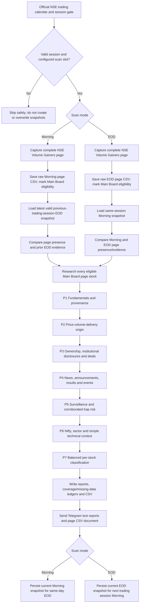

# ECMS end-to-end workflow design and P0–P8 implementation plan

**Decision baseline:** 16-Nov-2026  
**Repository:** `digitalmf78-pixel/AI-Trading-Bot`  
**Workflow:** `.github/workflows/ecms-volume-gainers-shadow.yml`

This document is the implementation map for the approved ECMS strategy. It does not authorize changes to NSE V8, shared providers/caches, production selection logic, broker execution, basket construction or historical backtesting.

## 1. Purpose and operating boundaries

ECMS researches every eligible Main Board equity returned by the NSE Volume Gainers page. It explains whether unusual volume has positive demand/accumulation evidence, negative selling/distribution evidence, a company/event catalyst, mixed signals or suspicious/high-risk characteristics.

A Volume Gainer is a **research candidate**, not a buy signal. No profit is guaranteed. Stocks are assessed individually; there is no basket construction, backtesting, auto-buy/sell or broker integration.

The NSE page currently labels its table “Top 25”. “All page stocks” means every row actually returned by the page response, not the entire NSE Main Board universe. Preserve all raw page rows in the downloadable Morning/EOD CSV and mark Main Board eligibility. Only eligible Main Board equities enter the ECMS research universe.

## 2. End-to-end daily flow

### Morning → EOD → next Morning state cycle

- **Morning of a trading session:** load the latest valid EOD snapshot from the previous trading session (not simply the previous calendar date). Compare it with the current Morning page and run the Morning research. Persist the current Morning snapshot only after its required report/persistence steps succeed.
- **Same-session EOD:** load that session's Morning snapshot, compare Morning and EOD page presence and update the research with completed-session data. Persist the EOD snapshot as the next trading session's Morning reference.
- **Next trading-session Morning:** consume the previous valid EOD reference only after its comparison/report persistence succeeds. A failed Morning comparison must not destroy the prior EOD reference.
- **Holiday/weekend:** skip the scan and do not create, consume or overwrite trading-session snapshots.
- **Friday EOD → Monday Morning:** compare Friday's EOD snapshot with Monday's Morning scan, provided Monday is an official trading session. If Monday is a holiday, the next valid session uses Friday's EOD.
- **Calendar uncertainty:** use only official NSE Capital Market–Equities calendar notices. Unknown calendar coverage or unconfigured special-session time fails closed; never infer holidays or special-session dates.

### Page capture and universe rules

1. Capture the NSE Volume Gainers page response and its capture/session timestamps.
2. Preserve every row returned by that page in the mode-specific CSV, including rows outside the Main Board research universe.
3. Add Main Board eligibility and the reason/source used to determine it.
4. Do not apply a Top-20/Top-25 research cap after capture. Research every eligible Main Board equity row.
5. Keep page-presence labels (new/repeated/disappeared) separate from fundamental PASS/FAIL/WAIT and from the final balanced classification.
6. Keep Morning and EOD CSVs and reports separate.

## 3. Research layers and evidence rules

### P1 — Fundamental quality

Collect seven applicable metrics for every eligible page stock:

- Revenue Growth
- Profit Growth
- ROE
- ROCE
- Debt/Equity
- Interest Coverage
- Operating Cash Flow

For every metric retain value, source, source URL, period end, publication date, consolidated/standalone basis, unit/currency, calculation method and verification status. Apply sector-specific applicability for banks, NBFCs and insurers.

**Decision policy:** a complete, current, period/basis-aligned and sufficiently official-verified set may pass or fail the approved fundamental rules. Missing, partial, stale, conflicting or unverified evidence remains WAIT/PARTIAL/STALE/CONFLICT and continues to other research layers. Do not call it a fundamental PASS or “fundamentally strong”. Never invent, silently average or overwrite conflicting values. Third-party data is provider evidence until reconciled to official filings.

### P2 — Positive/negative volume origin

Assess price, volume, traded value, liquidity, delivery quantity/percentage/value and follow-through. Use completed-session 5/10/20/30-session context where reliable. Compare up-day and down-day behaviour. Do not compare partial Morning volume directly with full-day averages. High delivery alone does not prove accumulation; a single volume spike does not prove distribution.

### P3 — Institutional and ownership evidence

Collect official quarterly shareholding changes, promoter holding/pledge, FII/DII observations and insider disclosures only where issuer/security mapping and source are verified. Add stock-specific NSE/BSE bulk/block deals with date, disclosed client/side, quantity, price and official source. Never infer an institutional buyer from delivery percentage or market-wide flows.

### P4 — News, announcements and events

Match issuer/security carefully. Capture official announcements, results, announced result dates, orders/contracts, material business updates, corporate actions and relevant news. Preserve publication date, event date, source type, URL and match confidence. If a date is not officially announced, report NOT ANNOUNCED rather than estimating it.

### P5 — Trap and surveillance risk

Check official ASM/GSM/ESM, Trade-to-Trade, Periodic Call Auction, price-band and exchange surveillance status. Combine official status with corroborating multi-session price/volume or disclosure evidence. **Exclude only for severe risk supported by a validated rule or corroborated evidence.** Maintain an exclusion ledger with symbol, session/date, source, evidence, severity and reason. Missing data or one weak signal is not a trap.

### P6 — Market and technical context

Add Nifty and sector strength, stock relative strength, simple trend/breakout/retest/closing-strength observations and liquidity/exit readiness. Keep this layer proportionate and avoid redundant or costly data collection.

### P7 — Balanced per-stock decision

Combine the separate evidence layers without hiding missing data in an opaque score. Suggested transparent labels:

- `POSITIVE_EVIDENCE`
- `NEGATIVE_EVIDENCE`
- `EVENT_DRIVEN`
- `MIXED_SIGNALS`
- `SUSPICIOUS_HIGH_RISK`
- `INSUFFICIENT_DATA`

Show confidence, reasons, evidence dates, source links and missing-data caveats. A classification is a research conclusion, never an automatic trade instruction.

## 4. P0–P8 delivery roadmap and phase gates

Work strictly in order. A phase is not complete because code was committed or unit tests passed alone. Each phase needs its stated runtime/data evidence. Do not begin the next phase until the current phase's acceptance evidence is reviewed.

| Phase | Scope | Required implementation | Acceptance evidence / exit gate |
|---|---|---|---|
| **P0 — Workflow protection** | Lifecycle, session dates, snapshots, cache, reports, Telegram, ECMS/V8 isolation | Verify official calendar/session gate; Morning previous-EOD restore/compare/consume; EOD same-day-Morning compare/save; holiday/failed-run safety; separate ECMS fundamental cache; complete page CSV and Telegram document delivery; preserve V8 workflows/providers/caches/thresholds. | Actual successful Morning and EOD runtime runs for both comparison legs; correct Friday/holiday/next-session handling; failed Morning does not consume EOD; no stale snapshot resurrection/overwrite; cache hit/reuse/provider-skip and save logs; both CSV Telegram deliveries confirmed; V8 regression checks pass. |
| **P1 — Fundamentals** | Seven-metric completeness and official verification | Per-stock/per-metric provenance; period, basis, unit and sector applicability; conflict/missing/stale states; persistent ECMS-only cache; retry and cache reuse; fundamental gate only for complete verified data. | Coverage matrix across all eligible stocks and seven metrics; source/official verification evidence; explicit PASS/FAIL/WAIT/PARTIAL counts; audited examples for each state; repeat-run cache reuse/provider-skip evidence; no incomplete-data false rejection. |
| **P2 — Volume origin** | Buying vs selling evidence | Price/volume/liquidity; session-aligned RVOL; delivery history for 5/10/20/30 completed sessions where available; up/down-day comparison; Morning/EOD follow-through. | Per-stock report with source and session dates; delivery/volume missingness explicit; test examples for positive, negative, mixed and insufficient evidence; no partial/full-session comparison errors. |
| **P3 — Institutional evidence** | Ownership, pledge, insider and deals | Official quarterly shareholding/promoter/pledge changes; verified insider filings; stock-specific bulk/block deals; mapping and period validation. | Source-attributed records with issuer, security, disclosure date, period and units; verified deal rows; no inferred institution identity; unavailable data clearly marked. |
| **P4 — News and events** | Catalyst and calendar context | Issuer-matched announcements, orders, results/result dates, corporate actions, upcoming events and relevant news; distinguish publication date from event date. | Auditable source URLs and date fields; correct issuer matching; announced vs not-announced distinction; Morning-to-EOD update evidence; no invented event dates. |
| **P5 — Trap/surveillance** | Evidence-backed risk exclusion | Official surveillance status plus validated corroborating signals; severity rules; exclusion ledger and reason codes. | Test cases for confirmed severe risk, single weak signal and missing data; only validated severe/corroborated cases excluded; full exclusion provenance. |
| **P6 — Market/technical context** | Sector, index and simple chart context | Nifty/sector relative strength, trend, breakout/retest, closing strength, liquidity and exit readiness. | Session-aligned and source-attributed outputs; market/sector context visible; missing inputs explicit; no heavy or duplicate indicators. |
| **P7 — Balanced classification** | Final research conclusion | Combine P1–P6 evidence into transparent per-stock labels, reasons and confidence; preserve independent layer statuses and exclusion reasons. | Auditable examples across all labels; every label traceable to evidence; WAIT/missing data not silently promoted or rejected; no opaque forced score or automatic trade instruction. |
| **P8 — Live shadow validation** | Operational proof and user review | Run only the existing Morning/EOD workflows on live sessions; inspect artifacts, reports, Telegram, snapshots, cache and data coverage; record defects and retest fixes. | Multiple real Morning/EOD cycles including a weekend/holiday transition where available; repeatability, data quality, delivery and state continuity accepted by user. **No historical backtesting.** |

## 5. Required report and audit outputs

Each scan should preserve:

- Raw page capture and complete mode-specific NSE page CSV.
- Main Board eligibility decisions and excluded-from-research reasons.
- Per-stock research output with independent P1–P6 statuses and P7 conclusion.
- Metric/source coverage and missing/stale/conflict ledger.
- Trap/surveillance exclusion ledger, if any.
- Morning/EOD comparison and snapshot lifecycle evidence.
- Cache restore/hit/reuse/save/provider-skip evidence.
- Telegram delivery status, document name, byte size and message identifier where available.
- Run date, intended session date, capture time, source timestamps and workflow run identifier.

## 6. Non-negotiable engineering rules

1. Only the ECMS workflow and ECMS-owned code/data/docs may be changed for ECMS work unless the user explicitly approves a broader change.
2. Do not alter NSE V8 workflow schedules, thresholds, selection logic, shared providers or shared caches.
3. Do not add basket construction, historical backtesting, broker integration or automatic orders.
4. Never treat missing/unavailable data as negative evidence or a trap.
5. Never claim a phase complete from a commit or unit tests alone; report exactly which runtime evidence is still missing.
6. Keep source provenance, dates, periods, units and basis attached to data throughout the pipeline.
7. Preserve every eligible page stock through collection and reporting; no silent shortlist drop.
8. Keep the system lightweight: batch requests, reuse ECMS-owned cache, avoid duplicate collection and log provider skips.
9. Run changes on the repository's **main** branch as requested, while isolating changes to ECMS paths/workflow.
10. No code change should be made to the live workflow merely to make a report look complete; missing evidence must remain visible.

## 7. Execution checklist

- [ ] P0 acceptance evidence complete
- [ ] P1 acceptance evidence complete
- [ ] P2 acceptance evidence complete
- [ ] P3 acceptance evidence complete
- [ ] P4 acceptance evidence complete
- [ ] P5 acceptance evidence complete
- [ ] P6 acceptance evidence complete
- [ ] P7 acceptance evidence complete
- [ ] P8 live shadow validation accepted

**Current status:** roadmap approved; phase completion must be determined from actual workflow runs, artifacts and source-coverage evidence, not inferred from this document.
